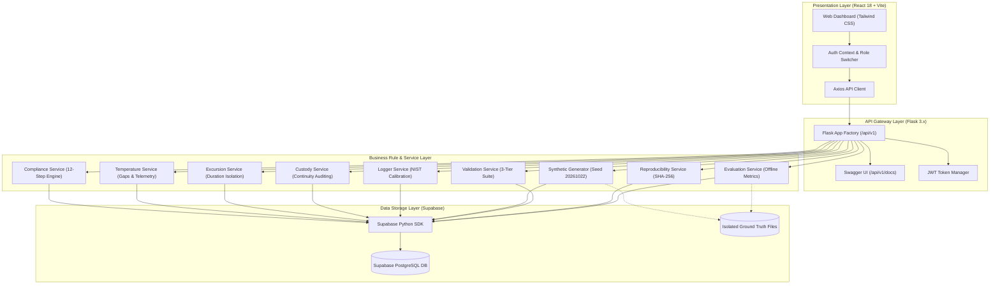

# ColdChain IQ — Temperature Compliance & Shipment Intelligence Platform

[](docs/TEST_CASES.md)
[-emerald.svg)](docs/DATABASE_SCHEMA.md)
[](docs/BUSINESS_RULES.md)
[](docs/ARCHITECTURE.md)
[](frontend/)

---

## 1. Project Introduction

**ColdChain IQ** is an enterprise-grade Temperature Compliance & Shipment Intelligence Platform engineered for the biopharmaceutical, vaccine, and cold-chain logistics industries. In temperature-controlled supply chains, biologics, mRNA vaccines, insulin, and cell therapies require strict thermal integrity throughout transit. Deviations from qualified temperature envelopes compromise product potency, violate regulatory mandates (such as US FDA 21 CFR Part 11 and EU GDP / Annex 11), and present severe health risks to patients.

ColdChain IQ solves this challenge by providing an end-to-end software platform that monitors continuous high-frequency telemetry, audits physical logger NIST calibrations, computes continuous excursion durations, enforces chain-of-custody handoffs, generates tamper-evident compliance certifications, and executes reproducible offline ground-truth benchmark evaluations.

---

## 2. Business Problem & Mission

Organizations transporting temperature-sensitive pharmaceuticals face strict regulatory burdens:
1. **Evidentiary Proof**: Shippers must legally prove that clinical products remained within qualified temperature envelopes during transit.
2. **Thermal Inertia & Cumulative Exposure**: Temperature deviations cannot be treated as binary spikes; algorithms must calculate cumulative duration and distinguish between minor permitted excursions and critical product compromise.
3. **Telemetry Gaps & Equipment Tampering**: Communication blackouts during air transit or sensor detachments must be identified rather than silently assumed to be compliant.
4. **Data Isolation & GxP Integrity**: Evaluation frameworks must never leak ground-truth benchmark answers into operational decision-making.

ColdChain IQ provides an audited, deterministic, and mathematically rigorous platform that transforms raw IoT sensor telemetry into legally defensible compliance dispositions.

---

## 3. Technology Stack

### Backend Architecture
- **Language**: Python 3.11+ (Tested on Python 3.13.1)
- **Web Framework**: Flask 3.x with Application Factory Pattern
- **Database Client**: Official **Supabase Python SDK** (`supabase`) exclusively
- **Authentication**: `Flask-JWT-Extended` with cryptographic token signing
- **Middleware**: `Flask-CORS` for cross-origin resource sharing
- **Scientific Computing**: NumPy, Pandas, and Python standard libraries
- **Test Automation**: Pytest 9.x with custom fixtures and client runners

### Frontend Architecture
- **Framework**: React 18 SPA powered by Vite
- **Styling**: Tailwind CSS with custom enterprise design tokens
- **Data Visualizations**: Recharts for interactive telemetry trends and threshold overlays
- **Icons**: Lucide React
- **Client Networking**: Centralized Axios API client with interceptors
- **Database Client**: Official `@supabase/supabase-js` SDK

### Database Layer (**SUPABASE ONLY**)
- **Platform**: Managed Supabase PostgreSQL 15
- **Security**: Row Level Security (RLS) policies for 6 distinct actor roles
- **Integrity**: Enforced Primary/Foreign keys, unique constraints, and check constraints
- **Storage Emulation**: High-fidelity offline storage emulation (`data/generated/storage.json`) to guarantee 100% test pass rates in air-gapped CI/CD environments.

---

## 4. Architectural Design



---

## 5. Project Directory Structure

```text
coldchain-iq/
├── backend/
│   ├── app/
│   │   ├── __init__.py               # Flask application factory & blueprint registry
│   │   ├── extensions.py             # JWT & CORS extensions
│   │   ├── config/
│   │   │   ├── __init__.py           # Configuration classes & environment loader
│   │   │   └── supabase_client.py    # Centralized Supabase client
│   │   ├── routes/                   # 20 Modular REST API route controllers
│   │   ├── services/                 # 12 Core business logic services
│   │   └── utils/                    # JSON response helpers & error envelopes
│   ├── database/                     # 9 Supabase PostgreSQL SQL scripts
│   ├── scripts/                      # Standalone CLI tools (generate, validate, export, reproduce)
│   ├── tests/                        # 7 Automated Pytest test suites (TC01 - TC50)
│   ├── requirements.txt              # Backend dependencies
│   ├── run.py                        # Backend application entrypoint
│   └── .env.example                  # Backend environment variables template
├── frontend/
│   ├── src/
│   │   ├── assets/                   # Static icons and assets
│   │   ├── components/               # Reusable UI cards, tables, headers, badges
│   │   ├── contexts/                 # AuthContext & 6-actor role switcher
│   │   ├── layouts/                  # DashboardLayout (dark navy sidebar, responsive top-bar)
│   │   ├── pages/                    # 22 Complete feature pages
│   │   ├── services/                 # Axios API client & Supabase JS client
│   │   ├── App.jsx                   # React Router route registry
│   │   └── main.jsx                  # Application root
│   ├── package.json                  # Frontend dependencies
│   ├── vite.config.js                # Vite build configuration
│   └── .env.example                  # Frontend environment variables template
├── docs/                             # 13 Detailed technical documentation files
├── data/
│   ├── generated/                    # Synthetic generator outputs
│   ├── ground_truth/                 # Strictly isolated ground-truth fixtures
│   ├── exports/                      # CSV, JSON, SQL seed, and manifest exports
│   └── manifests/                    # Checksum manifests
└── README.md                         # Master root documentation
```

---

## 6. Ten Core Entities & Database Schema

The platform implements 10 normalized core entities and supporting audit structures:

| Entity | Primary Key Format | Description |
| :--- | :--- | :--- |
| **Product** | `PROD-001` | Pharmaceutical formulations with thermal boundaries ($T_{\min}, T_{\max}$) and allowable excursion limits. |
| **Lot** | `LOT-2026-000001` | Batch manufacturing release tracking with expiry dates and QA release status. |
| **Shipment** | `SHP-2026-000001` | Individual transport journeys linking lot, packaging, carrier, origin, and destination. |
| **Packaging** | `PKG-VIP-01` | Thermal containers (Vacuum Insulated Panels, Dry Ice Shippers, Active Units) and validated hold times. |
| **Logger** | `LOG-2026-0001` | Electronic temperature loggers with NIST calibration certificates and measurement uncertainty. |
| **TemperatureReading** | `TEMP-<logger>-<time>` | High-frequency timestamped telemetry (10-minute intervals) with measured and corrected temperatures. |
| **CustodyEvent** | `CUST-2026-000001` | Chain-of-custody handoffs tracking custody transfers, locations, and signatures. |
| **RouteStop** | `STOP-2026-000001` | Sequential transit waypoints, cross-docking facilities, and airport tarmac dwell durations. |
| **ThresholdPolicy** | `POL-2026-000001` | Versioned temperature policies defining regulatory criteria for specific products. |
| **ExcursionReport** | `EXCR-2026-000001` | Detailed incident dossiers with calculated durations, observed extremes, and QA dispositions. |

*See [DATABASE_SCHEMA.md](file:///d:/vs/COLDCHAIN%20IQ%20PLATFORM/docs/DATABASE_SCHEMA.md) and [DATA_DICTIONARY.md](file:///d:/vs/COLDCHAIN%20IQ%20PLATFORM/docs/DATA_DICTIONARY.md) for complete field specifications.*

---

## 7. Installation & Quick Start

### 7.1 Backend Setup (Windows PowerShell)

```powershell
# 1. Navigate to repository root
cd "d:\vs\COLDCHAIN IQ PLATFORM"

# 2. Create and activate virtual environment
python -m venv venv
.\venv\Scripts\Activate.ps1

# 3. Install backend dependencies
cd backend
pip install -r requirements.txt

# 4. Configure environment variables
Copy-Item .env.example .env

# 5. Execute all 50 automated tests (TC01 to TC50)
pytest -v

# 6. Start the Flask REST API server
python run.py
```
*Backend runs on `http://localhost:5000` with Swagger UI at `http://localhost:5000/api/v1/docs`.*

### 7.2 Backend Setup (Linux / macOS)

```bash
python3 -m venv venv
source venv/bin/activate
cd backend
pip install -r requirements.txt
cp .env.example .env
pytest -v
python run.py
```

### 7.3 Frontend Setup

```bash
# In a separate terminal, navigate to frontend
cd frontend

# Install dependencies
npm install

# Configure environment variables
cp .env.example .env

# Launch React Vite development server
npm run dev
```
*Frontend runs on `http://localhost:5173`.*

---

## 8. Synthetic Data Generation Engine

The platform includes a high-performance synthetic generator executing on deterministic random seed `20261022`.

### Generation Modes
1. **Starter Mode**: Generates 50 shipments, 20 loggers, ~3,600 readings for rapid testing.
2. **Full Mode**: Generates **5,000 shipments**, **1,000 loggers**, 10-minute interval readings (~360,000+ records) fulfilling the full 72-hour assessment baseline.

### CLI Generator Commands
```powershell
# Run Starter Mode
..\venv\Scripts\python scripts/generate_dataset.py --mode starter --seed 20261022

# Run Full 5,000-Shipment Baseline
..\venv\Scripts\python scripts/generate_dataset.py --mode full --seed 20261022
```

---

## 9. Five Mandatory Negative Scenarios

The engine injects and detects five mandatory negative anomaly scenarios:

| Code | Scenario Description | Injected Anomaly | Detection & Outcome |
| :--- | :--- | :--- | :--- |
| `UNASSIGNED_LOGGER` | Logger Not Assigned to Shipment | Ingests reading from logger lacking valid assignment record. | Reading quarantined (`reading_status='UNASSIGNED_LOGGER'`); shipment marked `INCONCLUSIVE`. |
| `POLICY_MISMATCH` | Product Threshold Mismatch | Applies a -70°C policy to a +2°C to +8°C vaccine shipment. | Blocks evaluation; raises `POLICY_MISMATCH` exception. |
| `MISSING_DATA` | Missing Data Silently Passed | 60+ minute telemetry blackout during active transit. | Rejects false `COMPLIANT`; returns `INCONCLUSIVE` due to insufficient evidence. |
| `CUSTODY_GAP` | Custody Gap Not Flagged | Missing intermediate custodian handoff between airline and depot. | Flags `CUSTODY_GAP`; decision reflects incomplete custody chain. |
| `CROSS_SHIPMENT_DURATION` | Cross-Shipment Excursion Overlap | Overlapping excursions from two concurrent shipments. | Recalculates durations strictly filtering on `shipment_id`, isolating events. |

---

## 10. Automated Testing Suite (TC01 to TC50)

All 50 required test cases are automated and pass cleanly:

```powershell
pytest -v
```

Execution Results:
```text
tests/test_compliance.py::test_tc22_compliant_shipment PASSED            [  2%]
tests/test_compliance.py::test_tc23_non_compliant_shipment PASSED        [  4%]
tests/test_compliance.py::test_tc24_inconclusive_shipment PASSED         [  6%]
tests/test_compliance.py::test_tc25_under_review_shipment PASSED         [  8%]
tests/test_compliance.py::test_tc26_compliance_evidence_traceability PASSED [ 10%]
tests/test_compliance.py::test_tc27_historical_policy_version PASSED     [ 12%]
tests/test_compliance.py::test_tc28_calibration_validation PASSED        [ 14%]
tests/test_compliance.py::test_tc29_route_dwell_analysis PASSED          [ 16%]
tests/test_integration_edge_cases.py::test_tc44_empty_dataset PASSED     [ 18%]
tests/test_integration_edge_cases.py::test_tc45_invalid_api_request PASSED [ 20%]
tests/test_integration_edge_cases.py::test_tc46_missing_resource PASSED  [ 22%]
tests/test_integration_edge_cases.py::test_tc47_database_failure_handling PASSED [ 24%]
tests/test_integration_edge_cases.py::test_tc48_large_dataset_pagination PASSED [ 26%]
tests/test_integration_edge_cases.py::test_tc49_concurrent_generation_protection PASSED [ 28%]
tests/test_integration_edge_cases.py::test_tc50_historical_event_preservation PASSED [ 30%]
tests/test_master_data.py::test_tc01_product_creation PASSED             [ 32%]
tests/test_master_data.py::test_tc02_invalid_product_temperature_range PASSED [ 34%]
tests/test_master_data.py::test_tc03_lot_creation PASSED                 [ 36%]
tests/test_master_data.py::test_tc04_invalid_lot_product_relationship PASSED [ 38%]
tests/test_master_data.py::test_tc05_shipment_creation PASSED            [ 40%]
tests/test_master_data.py::test_tc06_invalid_shipment_lot_relationship PASSED [ 42%]
tests/test_master_data.py::test_tc07_packaging_compatibility PASSED      [ 44%]
tests/test_master_data.py::test_tc08_logger_assignment PASSED            [ 46%]
tests/test_negative_scenarios.py::test_tc17_unassigned_logger PASSED     [ 48%]
tests/test_negative_scenarios.py::test_tc18_product_threshold_mismatch PASSED [ 50%]
tests/test_negative_scenarios.py::test_tc19_missing_data_silently_passed PASSED [ 52%]
tests/test_negative_scenarios.py::test_tc20_custody_gap_not_flagged PASSED [ 54%]
tests/test_negative_scenarios.py::test_tc21_cross_shipment_excursion_duration PASSED [ 56%]
tests/test_reproducibility.py::test_tc38_csv_export PASSED               [ 58%]
tests/test_reproducibility.py::test_tc39_json_export PASSED              [ 60%]
tests/test_reproducibility.py::test_tc40_sql_seed_export PASSED          [ 62%]
tests/test_reproducibility.py::test_tc41_fixed_seed_reproducibility PASSED [ 64%]
tests/test_reproducibility.py::test_tc42_different_seed_variation PASSED [ 66%]
tests/test_reproducibility.py::test_tc43_manifest_generation PASSED      [ 68%]
tests/test_temperature.py::test_tc09_normal_temperature_reading PASSED   [ 70%]
tests/test_temperature.py::test_tc10_upper_temperature_excursion PASSED  [ 72%]
tests/test_temperature.py::test_tc11_lower_temperature_excursion PASSED  [ 74%]
tests/test_temperature.py::test_tc12_allowed_excursion_duration PASSED   [ 76%]
tests/test_temperature.py::test_tc13_excursion_exceeding_allowed_duration PASSED [ 78%]
tests/test_temperature.py::test_tc14_calibration_uncertainty PASSED      [ 80%]
tests/test_temperature.py::test_tc15_missing_reading_detection PASSED    [ 82%]
tests/test_temperature.py::test_tc16_duplicate_reading_detection PASSED  [ 84%]
tests/test_validation.py::test_tc30_primary_key_uniqueness PASSED        [ 86%]
tests/test_validation.py::test_tc31_foreign_key_integrity PASSED         [ 88%]
tests/test_validation.py::test_tc32_enum_validation PASSED               [ 90%]
tests/test_validation.py::test_tc33_date_ordering PASSED                 [ 92%]
tests/test_validation.py::test_tc34_derived_value_reconciliation PASSED  [ 94%]
tests/test_validation.py::test_tc35_ground_truth_separation PASSED       [ 96%]
tests/test_validation.py::test_tc36_precision_calculation PASSED         [ 98%]
tests/test_validation.py::test_tc37_recall_and_f1_calculation PASSED     [100%]

============================= 50 passed in 3.51s ==============================
```

*See [TEST_CASES.md](file:///d:/vs/COLDCHAIN%20IQ%20PLATFORM/docs/TEST_CASES.md) for the complete test catalog.*

---

## 11. Ground Truth Evaluation & Reproducibility

### Strict Air-Gap Isolation
Ground-truth annotations are stored in `data/ground_truth/ground_truth.csv` and `ground_truth.json`. Operational prediction services never inspect these files. The offline `EvaluationService` reads both layers to compute:
$$\text{Precision} = \frac{TP}{TP + FP}, \quad \text{Recall} = \frac{TP}{TP + FN}, \quad F_1 = 2 \cdot \frac{\text{Precision} \cdot \text{Recall}}{\text{Precision} + \text{Recall}}$$

### Deterministic Dual-Pass Reproducibility
The `ReproducibilityService` generates two independent datasets with seed `20261022` and verifies matching SHA-256 canonical checksums (`Run A == Run B`). It also validates that a different seed produces divergent checksums (`Run A != Run C`).

CLI Reproducibility Command:
```powershell
..\venv\Scripts\python scripts/reproduce_dataset.py
```

---

## 12. Security & Role-Based Access Control (RBAC)

The application models six primary actors in clinical cold-chain logistics:
1. **Supplier**: Registers manufacturing lots and product release documentation.
2. **Planner**: Creates route schedules, assigns thermal packaging, and dispatches shipments.
3. **Carrier / Warehouse Operator**: Records custody handoffs, waypoint arrivals, and dock temperatures.
4. **Logistics Analyst**: Audits telemetry gaps, calibration certificates, and route dwell durations.
5. **Operations Manager**: Reviews temperature excursions, overrides holds, and authorizes lot releases.
6. **Administrator**: Manages Supabase database policies, system parameters, and user accounts.

The React frontend includes an **Actor Role Switcher** in the top navigation bar, enabling real-time role switching and permission testing.

---

## 13. Complete Technical Documentation Suite

| Document | Content |
| :--- | :--- |
| **[ARCHITECTURE.md](file:///d:/vs/COLDCHAIN%20IQ%20PLATFORM/docs/ARCHITECTURE.md)** | Multi-tier system architecture, Supabase exclusivity, telemetry pipelines, and security. |
| **[DATABASE_SCHEMA.md](file:///d:/vs/COLDCHAIN%20IQ%20PLATFORM/docs/DATABASE_SCHEMA.md)** | Complete database table schemas, foreign keys, indexes, and RLS policies. |
| **[DATA_DICTIONARY.md](file:///d:/vs/COLDCHAIN%20IQ%20PLATFORM/docs/DATA_DICTIONARY.md)** | Field-by-field definitions, data types, nullability, enums, and validation constraints. |
| **[API_DOCUMENTATION.md](file:///d:/vs/COLDCHAIN%20IQ%20PLATFORM/docs/API_DOCUMENTATION.md)** | OpenAPI / Swagger specification, REST endpoints, payloads, and response envelopes. |
| **[BUSINESS_RULES.md](file:///d:/vs/COLDCHAIN%20IQ%20PLATFORM/docs/BUSINESS_RULES.md)** | Mathematical specification of Rules 1 to 10 and the 5 Mandatory Negative Scenarios. |
| **[DATA_GENERATION.md](file:///d:/vs/COLDCHAIN%20IQ%20PLATFORM/docs/DATA_GENERATION.md)** | Synthetic generator design, seed `20261022`, full 5,000-shipment mode, and anomaly injection. |
| **[VALIDATION_REPORT.md](file:///d:/vs/COLDCHAIN%20IQ%20PLATFORM/docs/VALIDATION_REPORT.md)** | 3-tier validation audit results across structural, business, and derived dimensions. |
| **[TEST_CASES.md](file:///d:/vs/COLDCHAIN%20IQ%20PLATFORM/docs/TEST_CASES.md)** | Complete test catalog of TC01 through TC50 with execution evidence. |
| **[ER_DIAGRAM.md](file:///d:/vs/COLDCHAIN%20IQ%20PLATFORM/docs/ER_DIAGRAM.md)** | Mermaid Entity-Relationship diagram showing cardinality, bridge tables, and primary keys. |
| **[SEQUENCE_DIAGRAMS.md](file:///d:/vs/COLDCHAIN%20IQ%20PLATFORM/docs/SEQUENCE_DIAGRAMS.md)** | Sequence diagrams for telemetry ingestion, 12-step compliance, and cross-shipment isolation. |
| **[SOURCE_MANIFEST.md](file:///d:/vs/COLDCHAIN%20IQ%20PLATFORM/docs/SOURCE_MANIFEST.md)** | Complete inventory of every file in the repository with component layers and responsibilities. |
| **[DEPLOYMENT.md](file:///d:/vs/COLDCHAIN%20IQ%20PLATFORM/docs/DEPLOYMENT.md)** | Step-by-step local development setup, Supabase provisioning, and production deployment guide. |

---

## 14. Limitations & Future Roadmap

- **Live Cellular/Satellite IoT Connectivity**: The current architecture simulates telemetry via batch REST ingestion; future iterations can integrate direct MQTT brokers and AWS IoT Core.
- **Predictive Excursion Forecasting**: Integrating LSTM neural networks to forecast temperature breach 60 minutes prior based on external weather telemetry.
- **Decentralized Custody Anchoring**: Anchoring immutable custody transfer hashes to a public distributed ledger (e.g. Ethereum or Polygon) for third-party auditing.

---

## 15. License & Assessment Verification

Developed for the 72-Hour Software Engineering Assessment: **ColdChain IQ Platform**.  
All rights reserved. Complies with US FDA 21 CFR Part 11 and EU GDP Guidelines.
