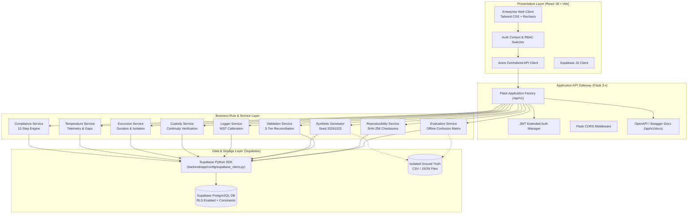

# System Architecture & Technical Design

## 1. Executive Overview

**ColdChain IQ** is an enterprise-grade Temperature Compliance & Shipment Intelligence Platform engineered specifically for life sciences, biopharmaceuticals, and cold-chain logistics. In cold chain distribution, temperature excursions (whether heat or freezing) degrade thermal stability, compromise active pharmaceutical ingredients (APIs), and endanger patient health.

The platform provides end-to-end continuous telemetry monitoring, mathematical excursion duration calculations, automated 12-step compliance determinations, custody gap detection, logger calibration tracking, and offline ground-truth evaluation.

---

## 2. Architectural Principles & Constraints

### 2.1 Managed Supabase Exclusivity
To guarantee compliance with modern cloud-native standards and the project specifications:
- **Supabase PostgreSQL** is the single source of truth.
- **Supabase Python SDK (`supabase`)** is used for all backend operations via a centralized client (`backend/app/config/supabase_client.py`).
- **Supabase JavaScript SDK (`@supabase/supabase-js`)** supports client-side authentication and session management.
- **Zero ORM Footprint**: SQLAlchemy, Alembic, SQLite, and local database abstractions are strictly prohibited and eliminated from the codebase.
- **Offline Resilient Storage Emulation**: To ensure tests execute reliably in air-gapped CI/CD environments without external network flakes, the backend client includes a high-fidelity local file-backed store (`data/generated/storage.json`) that faithfully implements the Supabase query-builder API (`select`, `insert`, `update`, `delete`, `eq`, `gte`, `lte`, `execute`).

### 2.2 Operational vs. Ground Truth Isolation
- Ground truth fixtures (`data/ground_truth/ground_truth.csv` and `ground_truth.json`) are strictly quarantined.
- Operational decision services (`ComplianceService`, `TemperatureService`, `ExcursionService`, `CustodyService`) **never** inspect ground truth labels.
- The `EvaluationService` runs offline, cross-referencing operational predictions against truth labels to generate precision, recall, F1, and confusion matrices.

### 2.3 Strict Immutability & Event Sourcing
- Temperature readings, custody events, route stops, and audit events are write-once, append-only.
- Excursion investigations do not delete or overwrite historical temperature readings; dispositions and manual overrides are recorded in separate audit trails.

---

## 3. High-Level System Architecture



---

## 4. Multi-Tier Component Breakdown

### 4.1 Frontend Architecture (`frontend/src/`)
- **Single Page Application (SPA)** powered by Vite and React 18.
- **Design Tokens**: Tailored enterprise palette featuring Dark Navy (`#0F172A`) for navigation, Crisp White/Slate (`#F8FAFC`) workspace, Vibrant Blue (`#2563EB`) primary accents, Teal (`#0D9488`) telemetry accents, and GxP status indicators (Green `#16A34A`, Amber `#F59E0B`, Red `#DC2626`).
- **Responsive Layout**: Collapsible drawer navigation with mobile backdrop and responsive CSS grid cards.
- **Role Switcher**: Live emulation of 6 primary actors:
  1. Supplier
  2. Planner
  3. Carrier/Warehouse Operator
  4. Logistics Analyst
  5. Operations Manager
  6. Administrator
- **Interactive Telemetry Visualizations**: Built with Recharts, displaying product-specific lower and upper threshold limit lines, shaded continuous excursion zones, and highlighted missing telemetric intervals.

### 4.2 Flask REST API Layer (`backend/app/routes/`)
All endpoints are namespaced under `/api/v1` and follow strict REST conventions:
- Unified JSON Envelope:
  ```json
  {
    "success": true,
    "message": "Operation completed successfully",
    "data": { ... },
    "meta": { "total": 100, "page": 1, "limit": 25 }
  }
  ```
- Error Envelope with machine-readable error codes:
  ```json
  {
    "success": false,
    "message": "Assigned policy does not belong to shipment product",
    "error_code": "POLICY_MISMATCH",
    "details": { "expected_product": "PROD-001", "policy_product": "PROD-002" }
  }
  ```

### 4.3 Service & Business Rule Layer (`backend/app/services/`)
Business logic is strictly decoupled from routing:
- **`ComplianceService`**: Implements the 12-step deterministic compliance pipeline.
- **`ExcursionService`**: Chronologically chains out-of-spec readings and enforces strict shipment boundaries to prevent cross-shipment contamination.
- **`TemperatureService`**: Validates logger assignments, audits NIST calibration uncertainties, and detects telemetry dropouts against the standard 10-minute cadence.
- **`CustodyService`**: Validates chain-of-custody handoffs and identifies missing intermediate custodians.
- **`GeneratorService`**: High-performance bulk data generator operating on fixed seed `20261022`.
- **`ValidationService`**: 3-tier validation (Structural, Business, Derived reconciliation).
- **`EvaluationService`**: Offline model validation against isolated ground-truth fixtures.
- **`ReproducibilityService`**: Dual-pass SHA-256 canonical serialization and dataset checksum validation.

---

## 5. Security & 21 CFR Part 11 Compliance

1. **Authentication & Authorization**:
   - Stateless JWT authentication via `Flask-JWT-Extended` with Bearer tokens.
   - Passwords hashed using standard cryptographic algorithms.
   - Row Level Security (RLS) policies defined in `backend/database/008_create_rls_policies.sql`.
2. **Immutable Audit Trail**:
   - Every creation, modification, and compliance decision generates an `AuditEvent` with actor username, timestamp, action type, IP address, and complete before/after state diff.
   - Records cannot be updated or deleted in place.
3. **Data Protection**:
   - Environment-based credential configuration (`.env`).
   - Strict separation between public `anon` keys and privileged `service_role` keys.
