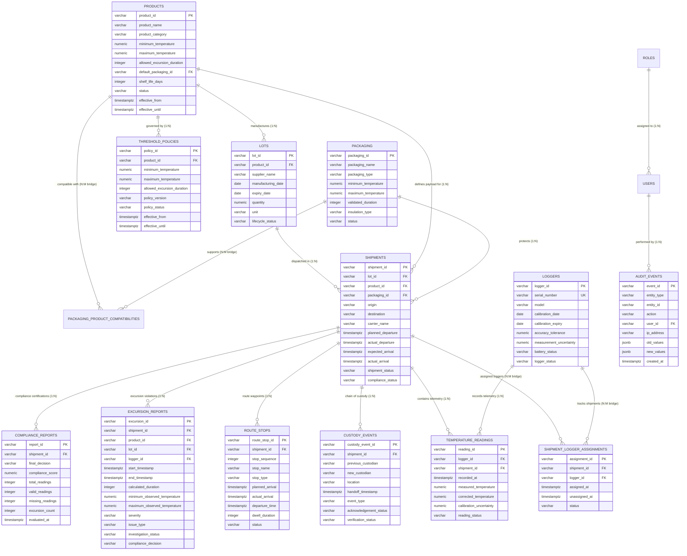

# ColdChain IQ — Entity-Relationship Diagram

## 1. Complete Database Entity-Relationship Model

---

## 2. Cardinality & Relationship Breakdown

1. **Product to Lots (`1:N`)**: A pharmaceutical product formulation is produced in multiple batch manufacturing lots. Each lot references exactly one product.
2. **Product to Packaging (`N:M`)**: Products have validated compatibility with specific packaging types through the `packaging_product_compatibilities` bridge table.
3. **Lot to Shipments (`1:N`)**: A manufacturing lot is distributed across multiple shipments.
4. **Shipment to Loggers (`N:M` via `ShipmentLoggerAssignment`)**: A shipment may be monitored by primary and backup loggers; a logger is reused across multiple shipments over its lifecycle.
5. **Shipment to Temperature Readings (`1:N`)**: A shipment aggregates hundreds or thousands of timestamped sensor observations.
6. **Shipment to Custody Events (`1:N`)**: Tracks chronological handoffs between shippers, airlines, ground handlers, and clinical consignees.
7. **Shipment to Excursion Reports (`1:N`)**: Captures zero, one, or multiple out-of-specification thermal incidents.
8. **Shipment to Compliance Reports (`1:N`)**: Preserves all compliance evaluation audits, maintaining historical policy versions and decision histories.
