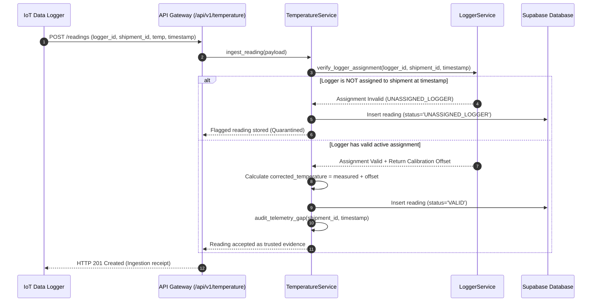
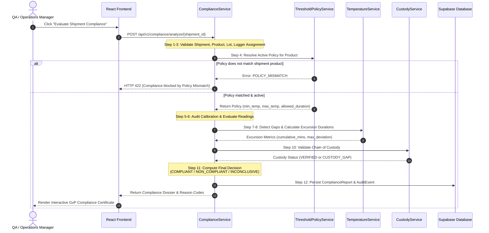
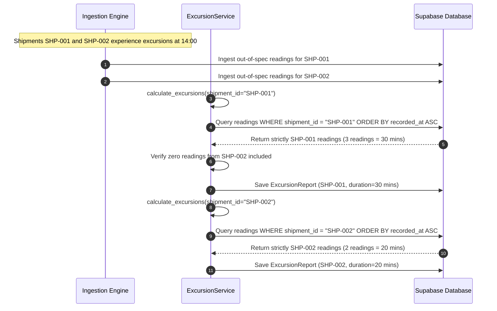
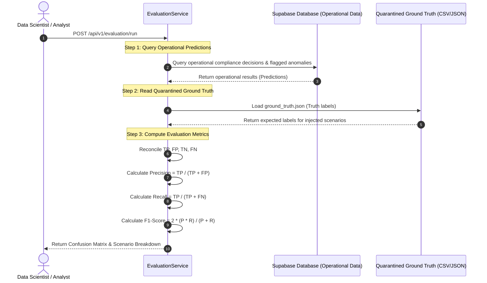

# ColdChain IQ — Sequence Diagrams

## 1. Sequence Diagram 1: Telemetry Ingestion & Real-Time Auditing

Demonstrates the lifecycle of an incoming temperature reading, verifying logger assignment, applying calibration uncertainty offsets, and flagging unassigned sensors.

---

## 2. Sequence Diagram 2: 12-Step Compliance Determination

Illustrates the deterministic evaluation of a delivered shipment, executing all 12 validation steps and generating a traceable compliance certificate.

---

## 3. Sequence Diagram 3: Cross-Shipment Excursion Isolation

Demonstrates how the engine isolates overlapping excursion readings between concurrent shipments, preventing cross-shipment contamination.

---

## 4. Sequence Diagram 4: Offline Ground-Truth Evaluation

Demonstrates the strict air-gap between operational detection inputs and ground-truth evaluation metrics.

