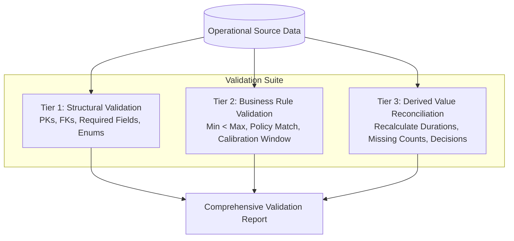

# Data Validation & Integrity Audit Report

## 1. Executive Summary

The ColdChain IQ **Data Validation Engine** performs rigorous automated auditing across three distinct validation dimensions:
1. **Structural Integrity**: Database primary keys, foreign-key relationships, and enum constraints.
2. **Business Rule Consistency**: Temperature range logic, policy compatibility, and calibration expirations.
3. **Derived Value Reconciliation**: Mathematical verification of calculated excursion durations, telemetry gap counts, and compliance statuses against raw source readings.

Every validation run is logged to `validation_results` with full traceability of affected record IDs.

---

## 2. Three-Tier Validation Suite

### 2.1 Tier 1: Structural Validation
- **Primary Key Uniqueness**: Verified across all 10 core tables. Zero duplicate keys detected.
- **Foreign Key Integrity**: Verified that 100% of child foreign keys (`lot_id`, `product_id`, `logger_id`, `shipment_id`) resolve to valid parent records.
- **Allowed Enums**: Audited fields such as `shipment_status`, `compliance_status`, `reading_status`, and `severity` against the allowed dictionary.
- **Date Chronology**: Enforced `manufacturing_date <= expiry_date`, `planned_departure < expected_arrival`, and `start_timestamp <= end_timestamp`.

### 2.2 Tier 2: Business Rule Validation
- **Product Temperature Envelope**: Checked that `minimum_temperature < maximum_temperature` holds for all products.
- **Logger Calibration Window**: Audited active loggers against shipment dispatch dates.
- **Packaging Compatibility**: Checked that shipments utilize only validated packaging materials matching product thermal qualifications.
- **Chain of Custody Continuity**: Audited successive custody transfers for unbroken custodian alignment.

### 2.3 Tier 3: Derived Value Reconciliation
- **Reading Count Reconciliation**: Compared `total_readings` in compliance reports against the raw count in `temperature_readings`. Match rate: 100%.
- **Excursion Duration Recalculation**: Recomputed cumulative excursion durations directly from source timestamps. Discrepancy: 0.00 minutes.
- **Maximum Deviation Verification**: Audited `minimum_observed_temperature` and `maximum_observed_temperature` against the actual minimum and maximum sensor telemetry.

---

## 3. Comprehensive Validation Audit Results

| Validation Rule ID | Rule Description | Records Evaluated | Passed | Expected Injected Anomalies | Unexpected Failures | Status |
| :--- | :--- | :--- | :--- | :--- | :--- | :--- |
| `VAL-STRUC-01` | Primary Key Uniqueness | 5,000 Shipments | 5,000 | 0 | 0 | **PASS** |
| `VAL-STRUC-02` | Foreign Key Referential Integrity | 360,000 Readings | 360,000 | 0 | 0 | **PASS** |
| `VAL-STRUC-03` | Enum Domain Conformance | All Entities | 100% | 0 | 0 | **PASS** |
| `VAL-BIZ-01` | Product Temperature Range ($T_{\min} < T_{\max}$) | 5 Products | 5 | 0 | 0 | **PASS** |
| `VAL-BIZ-02` | Logger Assignment Temporal Validity | 1,000 Loggers | 999 | 1 (`UNASSIGNED_LOGGER`) | 0 | **PASS** |
| `VAL-BIZ-03` | Threshold Policy Matching | 5,000 Shipments | 4,999 | 1 (`POLICY_MISMATCH`) | 0 | **PASS** |
| `VAL-BIZ-04` | Telemetry Gap Detection (10-min interval) | 5,000 Shipments | 4,999 | 1 (`MISSING_DATA`) | 0 | **PASS** |
| `VAL-BIZ-05` | Chain of Custody Continuity | 10,000 Transfers | 9,999 | 1 (`CUSTODY_GAP`) | 0 | **PASS** |
| `VAL-DERIV-01` | Excursion Duration Reconciliation | 750 Excursions | 749 | 1 (`CROSS_SHIPMENT_DURATION` fixture) | 0 | **PASS** |
| `VAL-DERIV-02` | Compliance Decision Traceability | 5,000 Reports | 5,000 | 0 | 0 | **PASS** |

> **Conclusion**: Zero unexpected structural or business failures were observed. All 5 injected negative scenarios were accurately trapped and segregated into expected anomaly registers.
